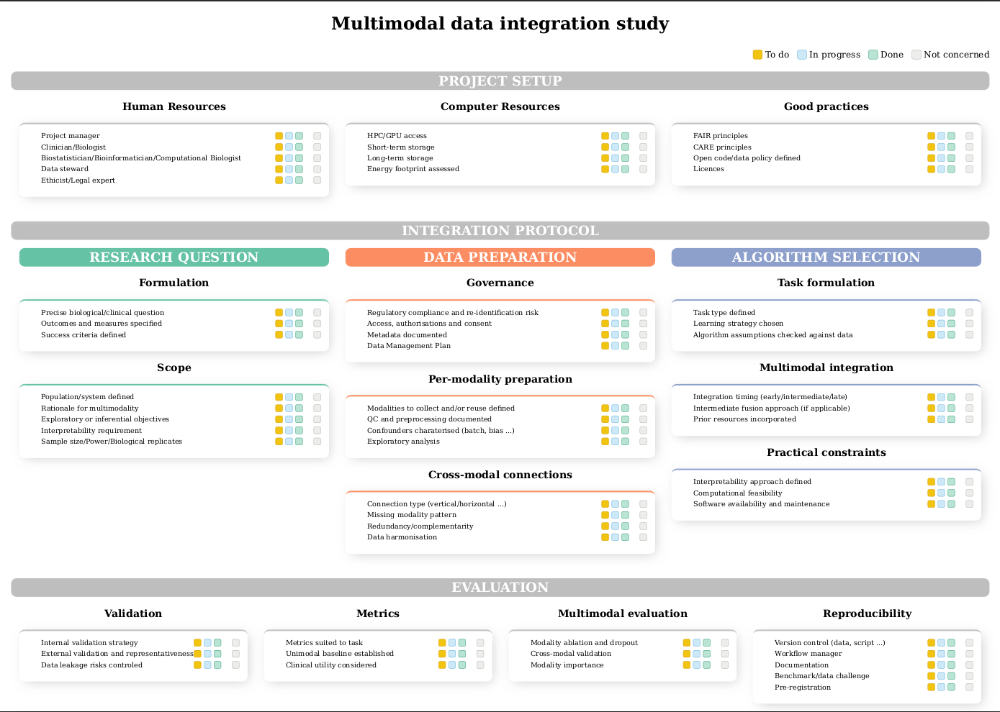

# Designing multimodal data integration strategies in biomedical research

Ongoing work!

Practical checklist to help the broader biomedical community (including medical practitioners, biologists, computational biologists and biostatisticians) to design multimodal data integration analysis.

<p align="center">


<figcaption>Figure 1: Guidelines for designing a data integration protocol in a biomedical context.</figcaption>

</p>

This repository contains files for the Figure 1 of the ongoing consortium paper.  
The idea is to provide a self-assessment questions and guidelines to researcher which want to perform integrative analysis.
The HTML file contains tickboxes to make informed decisions. It possible to add additional tickboxes depending of the needs.

### HOW TO USE IT

``` bash
git clone https://github.com/BAUDOTlab/M4DI/
```
The mainPage.html file corresponds to the main Figure 1 of the consortium paper. It contains tickboxes. 

Several functionalities are available: 
- Add tickboxes if necessary or remove those newly added,
- Print (paper/pdf) the page using the `Print page` button on the top left,
- Refresh the page (remove new tickboxes and uncheck boxes) using the `Refresh page` button on the top left.

Initial items are not deletable, but you can check the "not concerned" box in grey.

### TO DO
- [x] Check the removing event (list are removed if enter on keyboard)
- [x] Save the edited file - Possible but CSS is missing ...
- [ ] Find a way to not edit CSS path inside the HTML file (save into cookies is bad idea)
- [x] Change name files
- [x] ~Make github page to have a printed version~ - Add a printer button to save into PDF
- [x] Check the initial list of each section
- [x] Check sections
- [x] Custom titles
